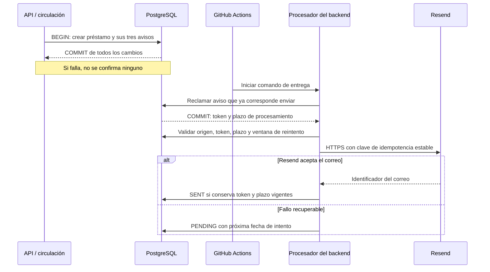

# ADR-0003 — Notificaciones con outbox transaccional y entrega externa

Estado: **propuesto para revisión**, 31 de octubre de 2026. El patrón outbox y la
ejecución periódica externa ya están aceptados en el
[ADR-001, versión 2](https://joaquincastellano350.atlassian.net/wiki/spaces/SCRUM/pages/5177345).
Este documento precisa sus mecanismos y registra las decisiones implementadas
en SCRUM-28 que todavía requieren review; no declara aprobada la implementación
ni autoriza su integración, publicación o activación.

Proponemos guardar los avisos en PostgreSQL junto con la operación que los
origina y entregarlos después mediante un comando del mismo backend, ejecutado
por GitHub Actions y conectado a Resend por HTTPS. Así se conserva el trabajo
ante fallos y se evita acoplar la concesión de un préstamo a la disponibilidad
del proveedor, aceptando demoras y una garantía de deduplicación externa limitada.

## Contexto y alcance

El [modelo de datos, §§4–8 y 10](../modelo-de-datos.md) exige que el cambio de
circulación y sus avisos se confirmen juntos. Un préstamo dura 480 horas y genera
avisos a las 240 horas, 72 horas antes del vencimiento y al vencer. La oferta de
una reserva y el rechazo por límite también originan avisos, según sus historias.

Guardar el préstamo y luego intentar guardar el correo dejaría un intervalo en
el que una caída pierde el aviso. Enviar antes del COMMIT podría anunciar un
préstamo finalmente revertido. PostgreSQL y Resend no comparten una transacción:
necesitamos separar el registro durable del trabajo de su efecto externo.

El envío no concede préstamos, no procesa vencimientos ni reasigna cupos. Esas
operaciones pertenecen a circulación. Un aviso tardío no prolonga el préstamo;
el enlace exige autenticación y las comprobaciones de dominio correspondientes.

## Responsabilidades y flujo

| Componente | Responsabilidad |
| --- | --- |
| Circulación | Decidir qué ocurrió y registrar los avisos dentro de su transacción. Para préstamos, reutilizar `scheduleLoanNotifications(tx, loan)`. |
| PostgreSQL / `notification_outbox` | Conservar destinatario, contenido de origen, fecha programada, estado, intentos y propiedad temporal del procesamiento. Es la fuente de verdad del trabajo pendiente. |
| `NotificationRepository` | Reclamar y finalizar avisos con reloj de base de datos, bloqueo de filas y token; comprobar titularidad y vigencia cuando corresponda. |
| `NotificationWorker` | Procesar un lote, validar el aviso, construir su mensaje y decidir entre confirmar, reintentar, cancelar o dejar para revisión. |
| `EmailSender` / `ResendEmailSender` | Separar el contrato de envío de los detalles de HTTPS y errores de Resend. |
| GitHub Actions | Iniciar el comando periódicamente. No conserva los avisos ni decide reglas de circulación. |
| Resend | Aceptar el correo y gestionar su entrega al sistema de correo del destinatario. |

El procesador es otro punto de entrada del mismo monolito modular, no un
microservicio ni una llamada al servidor web. Puede ejecutarse aunque Express
esté suspendido. No requiere un broker adicional: la tabla implementa el trabajo
durable del MVP. `scheduled_at` fija el momento previsto; `next_attempt_at` permite
aplazar reintentos sin perder esa fecha original.

## Concurrencia y recuperación

La implementación reclama una fila elegible con `FOR UPDATE SKIP LOCKED`, marca
`PROCESSING`, incrementa intentos y asigna un UUID y un plazo de 60 segundos.
Confirma esa transacción antes de la llamada HTTPS, cuyo timeout es de 15 segundos;
no mantiene un bloqueo de base durante la comunicación externa.

Solo el token propietario con plazo vigente puede registrar el resultado. Si el
proceso cae, otra ejecución puede reclamar directamente la fila `PROCESSING`
cuando vence el plazo. El token anterior deja de poder finalizarla. Esto coordina
los emisores en la base; la exclusión de ejecuciones de Actions es complementaria.
No hay renovación del plazo implementada: debe revisarse si cambian los tiempos
de procesamiento o del proveedor.

| Resultado | Estado persistido |
| --- | --- |
| Proveedor acepta el correo | `SENT`, con su identificador; no demuestra recepción en bandeja. |
| Error recuperable | `PENDING`, con espera creciente de 30 segundos hasta una hora. |
| Error permanente o contenido inválido | `FAILED`, conservando causa controlada y el aviso para revisión. |
| Origen inválido o turno que ya no está vigente | `CANCELLED`. |
| Caída sin registrar resultado | `PROCESSING` recuperable al vencer su plazo. |

Antes de enviar un turno se exige reserva `HELD`, plazo vigente y entrada
`OFFERED`. Existe una carrera entre esa comprobación y el envío externo; abrir el
enlace vuelve a validar la reserva. Para avisos de préstamo se verifica el titular,
pero cerrar el préstamo no cancela los recordatorios atrasados en la implementación
propuesta. Esa política de avisos tardíos también debe revisarse.

## Duplicados y límite de los reintentos

Una clave única por causa, por ejemplo `loan:{id}:day10`, evita crear dos filas
para el mismo aviso. Esa misma clave se envía a Resend como `Idempotency-Key`.
Si Resend acepta el correo y se pierde la respuesta, repetir la petición permite
recuperar el resultado sin generar otro correo dentro de su ventana de
[idempotencia de 24 horas](https://resend.com/docs/dashboard/emails/idempotency-keys).
La restricción UNIQUE de PostgreSQL por sí sola no resuelve ese fallo externo.

La propuesta implementada registra `first_attempt_at` desde la primera reclamación
y detiene los envíos automáticos al cumplirse 23 horas, dejando
`FAILED / DELIVERY_WINDOW_EXPIRED`. Se mide conservadoramente incluso si ese
primer proceso cayó antes de llamar al proveedor. La espera anterior al primer
intento no consume esta ventana. Los intentos históricos sin fecha conocida
quedan fuera de ventana mediante la migración de SCRUM-28.

**Esta política requiere aprobación explícita en la review:** evita reintentar
fuera de la garantía del proveedor, pero una interrupción prolongada requiere
intervención. No ofrece reintentos automáticos indefinidos ni entrega externa
exactamente una vez. Fuera de ventana debe comprobarse el resultado en Resend
antes de decidir cómo resolver la misma fila; no basta con reiniciar su fecha.
Todavía no existe una herramienta administrativa para esa recuperación.

Los reintentos necesitan conservar clave y contenido. La implementación guarda
el destinatario y los datos del mensaje, pero reconstruye el texto con la plantilla,
el remitente y el origen configurados. Cambiar esos elementos mientras existen
envíos inciertos puede alterar la petición: debe definirse cómo conservar su
compatibilidad antes de modificar plantillas o configuración.

## Ejecución propuesta para el MVP

El workflow inicia `notifications:deliver` cada hora, al minuto 17, y admite
ejecución manual. Cada invocación procesa hasta 20 filas secuencialmente. Utiliza
la misma base que la API, credenciales de correo fuera del frontend y una variable
`NOTIFICATIONS_ENABLED` para habilitar el trabajo. El comando no aplica migraciones.

Actions puede retrasar u omitir ejecuciones y su programación utiliza la rama
predeterminada, según su
[documentación](https://docs.github.com/en/actions/reference/workflows-and-actions/events-that-trigger-workflows#schedule).
Por eso la frecuencia no garantiza una entrega dentro de una hora. Si se acumula
trabajo, los siguientes lotes continúan; el límite de lote y la espera de reintentos
pueden aumentar la demora. La ventana de entrega se mide desde el primer intento,
no desde la fecha prevista del aviso.

La selección de Actions reduce servicios para el MVP, pero requiere revisar
capacidad y demoras. La activación debe coordinarse con la release aprobada;
la necesidad de publicar el workflow en la rama predeterminada no justifica
adelantar una release ni integrar código sin review.

## Alternativas y consecuencias

- **Enviar desde la solicitud HTTP:** acopla la respuesta al proveedor y no resuelve
  la atomicidad entre la base y el correo. Se mantiene descartado según ADR-001.
- **Temporizador en Express y tareas en memoria:** depende de que el servidor esté
  activo; los reinicios pierden tareas en memoria. Se prefiere el registro durable
  con ejecución externa ya establecido en ADR-001.
- **Broker y servicio dedicado:** aportan herramientas de consumo y escalado,
  pero agregan infraestructura y no eliminan la necesidad de registrar el evento
  de manera atómica ni de tratar duplicados externos. Se difieren para el MVP.
- **Otro ejecutor periódico:** puede sustituir Actions conservando outbox y comando
  si necesitamos menor demora o más capacidad. Otro proveedor puede implementar
  `EmailSender`, pero obliga a revisar sus garantías de idempotencia y errores.

Antes de aceptar esta propuesta quedan por revisar la ventana de 23 horas,
la recuperación manual, los avisos atrasados y la estabilidad del contenido.
Falta validar contención con varias conexiones a PostgreSQL y acordar cómo
detectar avisos fallidos: un comando exitoso no significa que todos se entregaron.
El código tampoco incorpora todavía un limitador de ritmo ni respeta `Retry-After`.

La [guía de SCRUM-28](../scrum-28-avisos.md) conserva detalles de implementación,
configuración y pruebas. SCRUM-26 debe programar los avisos al conceder el préstamo
por reserva; SCRUM-25 debe integrar sus productores con el emisor compartido;
SCRUM-27 debe conservar el aviso de vencimiento existente. Este ADR documenta
arquitectura y decisiones pendientes, no el estado operativo de cada entorno.
