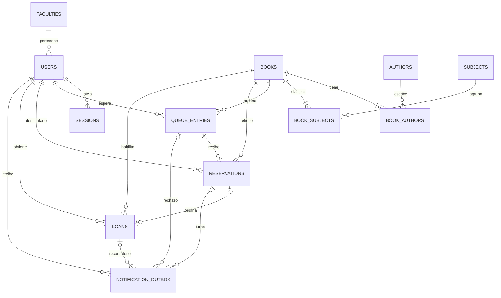

# Modelo de datos — Biblioteca Digital Universitaria

[Documento de revisión en Confluence](https://joaquincastellano350.atlassian.net/wiki/spaces/SCRUM/pages/6389762).

Estado: Propuesta v1 para revisión. Fecha: 17 de octubre de 2026. Alcance: modelo lógico y decisiones para su traducción a PostgreSQL; todavía no es una migración ejecutable.

Basado en el PRD v7, el ADR-001 aceptado y las tres épicas con sus historias. Incorpora el catálogo reducido y el rechazo inmediato de una reserva cuya aceptación superaría cinco préstamos activos. Las elecciones de estructura y mecanismos técnicos de este documento son propuestas de diseño; las reglas de producto provienen de esas fuentes.

## 1. Conceptos y alcance

| Concepto | Significado |
| --- | --- |
| Libro | Entrada del catálogo asociada a un PDF privado. Para el MVP se trata como una unidad prestable; no se separan obra, edición y formato. |
| Cupo | Unidad de capacidad simultánea de un libro. Se guarda una cantidad total por libro; no se crean ejemplares ni licencias comerciales. |
| Préstamo | Derecho de lectura de un estudiante sobre un libro durante 480 horas. |
| Entrada en cola | Espera ordenada de un estudiante para un libro. Su posición es calculada. |
| Reserva | Cupo asignado a una entrada en cola durante 24 horas, pendiente de aceptación. |
| Aviso pendiente | Correo programado o listo para envío, guardado de forma durable y vinculado a su causa. |

Se incluyen cuentas, sesiones, catálogo, préstamos, colas, reservas y avisos por correo. El catálogo muestra título, autores, materias y cupos disponibles/total. Los PDFs quedan fuera de PostgreSQL; solo se conserva su clave de almacenamiento. La carga inicial incluye las facultades de SCRUM-7, los autores, materias, libros y sus cupos.

Quedan fuera reseñas, calificaciones, portada, descripción, editorial, edición e ISBN como requisitos de esta entrega; tampoco se modelan administración del catálogo, renovación, devolución anticipada ni lectura offline. Conservar registros finalizados sirve para integridad, reintentos y enlaces antiguos; no incorpora una pantalla de historial.

## 2. Diagrama entidad-relación

Las tres relaciones opcionales que llegan al outbox son alternativas: cada aviso referencia exactamente un préstamo, una reserva o una entrada en cola. Cada reserva pertenece a una única entrada en cola y puede originar como máximo un préstamo. Un préstamo directo no tiene reserva.

## 3. Diccionario de entidades

Convenciones: PK = clave primaria; FK = referencia; ? = campo opcional. Salvo las tablas de relación, las PK son UUID; order_seq es bigint identity. Las fechas son timestamptz y se comparan como instantes UTC. Los nombres de tablas propuestos están en inglés para el código; el vocabulario de producto se mantiene en español.

| Tabla / responsable | Atributos y tipos principales | Relaciones y restricciones |
| --- | --- | --- |
| faculties · Cuentas | id UUID PK; code text; name text | code único y obligatorio. Lista cerrada cargada desde SCRUM-7; un usuario pertenece a una facultad. |
| users · Cuentas | id UUID PK; first_name text; last_name text; faculty_id UUID FK; email text; email_normalized text; password_hash text; created_at timestamptz | Datos obligatorios; email_normalized único. Normalización propuesta: quitar espacios exteriores y convertir a minúsculas. Contraseña guardada como hash; el dominio del correo es libre. |
| sessions · Cuentas | id UUID PK; user_id UUID FK; token_hash text; created_at timestamptz; expires_at timestamptz; revoked_at timestamptz? | token_hash único. expires_at = created_at + 6 horas. La actividad no extiende el vencimiento. Al cerrar sesión se revoca la sesión del dispositivo. |
| books · Catálogo | id UUID PK; title text; title_search text; pdf_object_key text; total_copies integer; created_at timestamptz | title y clave de PDF obligatorios; total_copies >= 0. title_search contiene la forma normalizada para búsqueda parcial sin mayúsculas ni tildes. No se guarda una URL firmada. |
| authors · Catálogo | id UUID PK; name text; name_search text | Nombre obligatorio; no es identificador único: pueden existir homónimos. name_search facilita buscar opciones del filtro. |
| subjects · Catálogo | id UUID PK; name text; name_search text | Nombre obligatorio. Diccionario de materias cargado inicialmente; name_search facilita buscar opciones del filtro. |
| book_authors · Catálogo | book_id UUID FK; author_id UUID FK; display_order integer | PK (book_id, author_id); display_order >= 1 y único por libro. Define un orden estable de presentación. |
| book_subjects · Catálogo | book_id UUID FK; subject_id UUID FK; display_order integer | PK (book_id, subject_id); display_order >= 1 y único por libro. |
| queue_entries · Circulación | id UUID PK; user_id UUID FK; book_id UUID FK; order_seq bigint identity; joined_at timestamptz; state text; closed_at timestamptz? | order_seq único. Solo una entrada abierta WAITING/OFFERED por estudiante y libro. closed_at es obligatorio en estados terminales y nulo en estados abiertos. |
| reservations · Circulación | id UUID PK; queue_entry_id UUID FK; user_id UUID FK; book_id UUID FK; offered_at timestamptz; expires_at timestamptz; state text; closed_at timestamptz? | queue_entry_id único: una oferta por entrada. expires_at = offered_at + 24 horas. El usuario y libro deben coincidir con los de la entrada. closed_at depende del estado. |
| loans · Circulación | id UUID PK; user_id UUID FK; book_id UUID FK; reservation_id UUID FK?; started_at timestamptz; due_at timestamptz; closed_at timestamptz? | due_at = started_at + 480 horas. reservation_id único cuando existe; debe pertenecer al mismo usuario y libro. Solo un préstamo sin cerrar por estudiante y libro. |
| notification_outbox · Notificaciones | id UUID PK; user_id UUID FK; loan_id UUID FK?; reservation_id UUID FK?; queue_entry_id UUID FK?; kind text; dedup_key text; recipient_email text; payload jsonb; scheduled_at timestamptz; next_attempt_at timestamptz; state text; attempt_count integer; claimed_at timestamptz?; lease_expires_at timestamptz?; claim_token UUID?; sent_at timestamptz?; provider_message_id text?; last_error text?; created_at timestamptz | dedup_key único; attempt_count >= 0. Exactamente una referencia de origen. scheduled_at conserva el momento previsto y next_attempt_at controla reintentos. El payload guarda solo los datos del correo; la vigencia y titularidad se consultan en las entidades del dominio. |

Las FK de circulación y avisos restringen el borrado de sus orígenes. Para evitar relaciones incoherentes, se proponen FK compuestas: reservations(queue_entry_id, user_id, book_id) → queue_entries(id, user_id, book_id), y loans(reservation_id, user_id, book_id) → reservations(id, user_id, book_id), con claves UNIQUE de soporte en los destinos. Una reserva sin préstamo sigue teniendo ambos identificadores para validar la titularidad y contar cupos.

Cada libro inicial debe tener al menos un autor y una materia. Esta cardinalidad mínima se valida en la carga inicial y en el servicio de catálogo; una FK por sí sola solo garantiza que las relaciones existentes sean válidas. El PDF asociado a un libro no se sustituye durante la vigencia de sus préstamos en el MVP.

## 4. Estados y transiciones

| Entidad | Estados / transiciones | Efecto |
| --- | --- | --- |
| Préstamo | VIGENTE si started_at <= t < due_at y closed_at es nulo. VENCIDO si t >= due_at. Son estados derivados; no se guarda un estado ACTIVE que dependa de un proceso periódico. | closed_at registra cuándo se procesó su cierre y solo puede establecerse desde due_at. No existe devolución anticipada ni renovación. |
| Entrada en cola | WAITING → OFFERED al asignar un cupo; OFFERED → FULFILLED al aceptarlo. | WAITING participa en el orden de espera. OFFERED se muestra como reserva disponible para aceptar. |
| Entrada en cola | WAITING/OFFERED → CANCELLED por salida voluntaria; OFFERED → EXPIRED por plazo; WAITING/OFFERED → REJECTED_LIMIT cuando se rechaza por cinco préstamos. | Estados terminales. Se retira de las esperas activas; una nueva solicitud posterior crea otra entrada al final. |
| Reserva | HELD → CONSUMED al aceptar; HELD → EXPIRED por plazo; HELD → CANCELLED al salir; HELD → REJECTED_LIMIT al aceptar con cinco préstamos activos. | Solo HELD con expires_at > t ocupa un cupo. Todos los destinos son terminales; no se reactiva una reserva antigua. |
| Sesión | Vigente mientras revoked_at sea nulo y t < expires_at; revocada o vencida en otro caso. | La autorización comprueba ambos campos en cada solicitud protegida. |
| Aviso | PENDING → PROCESSING al reclamar; PROCESSING → SENT al confirmar; PROCESSING → PENDING ante fallo recuperable. | El fallo conserva el aviso, incrementa intentos y programa next_attempt_at. |
| Aviso | PENDING/PROCESSING → CANCELLED si el turno perdió vigencia; PROCESSING con lease vencido → PENDING para recuperación. | La confirmación o cancelación requiere el claim_token vigente. Errores permanentes quedan en FAILED, con datos para revisión y reintento; nunca se borran silenciosamente. |

HELD no basta para que una reserva sea válida: también debe no haber vencido. Lo mismo ocurre con préstamos y sesiones. La hora del navegador no decide estas condiciones. El límite exacto es exclusivo: en t = due_at termina el préstamo y en t = expires_at ya no se acepta una reserva.

FULFILLED implica una reserva CONSUMED y un préstamo vinculado. OFFERED implica una reserva HELD; puede estar vencida por fecha aunque su cierre aún esté pendiente de procesamiento. Estas transiciones se realizan juntas en la misma transacción. Un préstamo procedente de una reserva empieza en el instante de aceptación, no en el momento de oferta ni de recepción del correo.

## 5. Integridad y datos derivados

| Regla | Garantía propuesta |
| --- | --- |
| Correo único, sesión única por token y relaciones válidas | UNIQUE, NOT NULL y FK. El correo se valida y normaliza antes de registrarlo. |
| Una espera abierta por usuario y libro | Índice UNIQUE parcial en (user_id, book_id) para state IN ('WAITING', 'OFFERED'). Incluye a quien ya tiene una oferta. |
| Un préstamo abierto por usuario y libro | Índice UNIQUE parcial en loans(user_id, book_id) WHERE closed_at IS NULL. Antes de crear uno se cierra cualquier préstamo vencido de ese par dentro de la transacción. |
| Una reserva y un préstamo por oferta | UNIQUE(reservations.queue_entry_id) y UNIQUE(loans.reservation_id). Las referencias compuestas conservan el usuario y libro originales. |
| Un evento de correo por causa | UNIQUE(dedup_key). El tipo y la FK de origen deben corresponderse; se valida que el destinatario sea el titular de ese origen. |
| Capacidad del libro | En cada concesión: préstamos vigentes + reservas vigentes <= books.total_copies. Se evalúa dentro de la transacción de circulación. |
| Límite del estudiante | En cada concesión directa o por reserva: préstamos vigentes del usuario < 5 antes de crear el nuevo. Las reservas no se cuentan como préstamos. |
| Préstamo incompatible con espera del mismo libro | La entrada en cola exige no tener préstamo vigente. El préstamo por reserva consume su espera; el préstamo directo exige que ese usuario no tenga una espera u oferta abierta para ese libro. |
| Duraciones y cierres | CHECK de 480 horas para préstamos, 24 horas para reservas y 6 horas para sesiones. CHECK de closed_at y los campos de procesamiento según el estado. No usar condiciones que dependan de now() en índices únicos parciales. |
| Prioridad de la cola | Conciliar el libro y asignar sus cupos a la cola antes de conceder un préstamo directo o informar cupos solicitables. |

Los límites que involucran varias filas y tablas se garantizan mediante las operaciones transaccionales de circulación; no mediante un CHECK que cuente otras filas. Todas las escrituras que afecten a esa capacidad, incluidos procesos periódicos y cargas posteriores, deben usar el mismo protocolo.

La disponibilidad se calcula como total_copies − préstamos vigentes − reservas vigentes, después de atender a quienes esperan. No se guarda un contador editable de disponibles. La posición se calcula entre las entradas WAITING del mismo libro, por order_seq ascendente; las ofertas se muestran por separado con su plazo. El orden es el de ingreso serializado para ese libro y no depende de que los números sean consecutivos.

Los campos title_search y name_search se generan con una función común y determinista de normalización del servicio. Los filtros combinan AND entre título, autores y materias, y OR dentro de cada selección. Las relaciones se consultan con EXISTS o deduplicación equivalente para no repetir libros con varios autores o materias.

## 6. Concurrencia, reloj y conciliación

Propuesta: todas las transacciones que cambian circulación usan aislamiento SERIALIZABLE. Se bloquea la fila del libro antes de asignar orden o cupos; si una operación necesita varios libros, se bloquean por id ascendente. Los conflictos de serialización y los interbloqueos requieren reintentar la transacción completa con un nuevo instante t. Los intentos son limitados por solicitud; si se agotan, se informa un resultado reintentable sin confirmar una concesión.

El bloqueo del libro coordina su cola, pero no basta para el límite del estudiante entre libros distintos. Todas las concesiones leen el conjunto de préstamos vigentes de ese estudiante y vuelven a validar dentro de la transacción SERIALIZABLE. Solo se informa éxito después del COMMIT. Los reintentos no envían correos ni realizan llamadas externas; escriben avisos en el outbox.

t se obtiene del reloj de PostgreSQL después de adquirir los bloqueos del intento. Las operaciones son breves y vuelven a comprobar el plazo justo antes de consumir una reserva. Las duraciones se expresan en horas transcurridas; la interfaz presenta los instantes en la zona del usuario. No se depende de medianoche ni de cambios de horario local.

Conciliar un libro significa: cerrar sus préstamos vencidos; finalizar las reservas cuyo plazo terminó y sus entradas; calcular cupos libres; recorrer WAITING por order_seq; rechazar a quienes ya tienen cinco préstamos vigentes, registrando el correo exigido por SCRUM-25; y crear reservas y sus avisos para las primeras personas elegibles, hasta agotar capacidad o cola. Cada reserva nueva tiene 24 horas desde su creación efectiva, aunque el procesamiento haya llegado tarde.

La conciliación se ejecuta al procesar vencimientos y antes de solicitar un préstamo, entrar o salir de una cola o aceptar una reserva. Al recargar el catálogo o las esperas propias también se concilian los libros que tengan trabajo vencido o cupos pendientes de asignación, antes de devolver la disponibilidad y las ofertas. Así una llamada pública no muestra un cupo como solicitable mientras deba ofrecerse primero a la cola.

La API devuelve únicamente el conteo público del catálogo y los préstamos, esperas y reservas del usuario autenticado. Las consultas se filtran por el usuario de la sesión; conocer un UUID no concede acceso. Las listas de autores y materias se obtienen de sus diccionarios, sin depender del subconjunto de libros filtrados.

## 7. Operaciones que deben ser atómicas

| Operación | Lecturas y cambios en una transacción |
| --- | --- |
| Préstamo directo | Conciliar libro → comprobar capacidad, préstamos del usuario y ausencia de espera propia → crear préstamo → programar tres avisos. Si el cupo se agotó, no crear préstamo y ofrecer la acción de cola. |
| Unirse a una cola | Conciliar libro → comprobar que no haya cupos solicitables, que el usuario tenga menos de cinco préstamos y que no posea ese libro → comprobar entrada abierta → crear WAITING con order_seq. Una repetición devuelve la entrada existente. |
| Ofrecer un cupo | Seleccionar la primera WAITING elegible → crear reserva HELD → pasar la entrada a OFFERED → registrar aviso de turno. Repetir mientras haya cupos. |
| Aceptar reserva válida | Comprobar sesión, destinatario y plazo → revisar otra vez los préstamos vigentes → pasar HELD a CONSUMED y entrada a FULFILLED → crear préstamo con reservation_id → programar avisos. La ocupación pasa de reserva a préstamo, sin sumar un cupo adicional. |
| Aceptar con cinco préstamos | Rechazar → pasar reserva y entrada a REJECTED_LIMIT y registrar su cierre → conciliar para ofrecer el cupo de inmediato a la siguiente persona elegible, o dejarlo libre → confirmar cambios y responder el motivo. El rechazo de negocio no debe hacer ROLLBACK de la cancelación y la reasignación. |
| Salir o vencer una reserva | Cerrar reserva y entrada con su motivo → conciliar y registrar los nuevos avisos. Una repetición no modifica de nuevo el resultado. |
| Vencer préstamo | Cerrar el registro si aún no se procesó → mantener el aviso de vencimiento ya programado, sin duplicarlo → conciliar cola y crear reservas y avisos correspondientes. |
| Abrir PDF | Comprobar titularidad y started_at <= t < due_at → emitir URL cuya duración no exceda el mínimo entre el plazo breve configurado y el tiempo restante. La clave del PDF permanece privada. |
| Cerrar sesión | Marcar revoked_at para la sesión autenticada. La siguiente solicitud protegida debe rechazarla. |

El enlace de turno identifica la reserva pero no sustituye la autenticación. La página realiza la aceptación autenticada al abrirse; si hace falta iniciar sesión, conserva el identificador y continúa después. Una reserva CONSUMED devuelve el préstamo que ya originó; una EXPIRED, CANCELLED o REJECTED_LIMIT devuelve su resultado terminal. Las comprobaciones de titularidad ocurren antes de revelar esos datos.

Si dos solicitudes intentan consumir la misma reserva, solo una puede crear el préstamo; la otra obtiene el resultado existente al reintentar. Una repetición de préstamo directo para un libro que ya está vigente devuelve el préstamo existente sin crear otro. No se agrega una tabla genérica de idempotencia para este alcance.

## 8. Outbox y entrega de correo

| Tipo de aviso | Origen y momento | Clave lógica propuesta |
| --- | --- | --- |
| TURN_AVAILABLE | Reserva; programado al ofrecerla. | reservation:{id}:turn |
| QUEUE_LIMIT_REJECTED | Entrada en cola; al descartarla por cinco préstamos al llegar su turno. | queue:{id}:limit |
| LOAN_DAY_10 | Préstamo; started_at + 240 horas. | loan:{id}:day10 |
| LOAN_DUE_IN_3_DAYS | Préstamo; due_at − 72 horas. | loan:{id}:due3 |
| LOAN_EXPIRED | Préstamo; due_at. | loan:{id}:expired |

Los tres avisos de un préstamo se programan en la misma transacción que lo crea, con scheduled_at futuro. La fecha futura representa un envío programado, no un vencimiento ya ocurrido. La cancelación por límite al aceptar informa el motivo en la respuesta; no añade un correo distinto a los exigidos por las historias.

El proceso reclama avisos cuyo scheduled_at y next_attempt_at ya llegaron, con bloqueo de filas y SKIP LOCKED, asigna claim_token y una concesión temporal de procesamiento, y confirma esa reclamación antes de llamar al proveedor. El resultado solo se registra si ese token sigue siendo el propietario. Un proceso caído deja trabajo recuperable al vencer la concesión; la duración y su renovación deben cubrir la llamada HTTPS.

Antes de enviar un aviso de turno se revisan de nuevo el estado HELD, el destinatario y expires_at. Si la reserva ya no está vigente, el aviso se cancela. Existe una pequeña carrera entre esa revisión y el envío externo: el enlace vuelve a comprobar la reserva al abrirse y nunca habilita un préstamo inválido.

La clave única impide duplicar avisos en la base, pero no garantiza por sí sola un único correo si el proveedor aceptó un envío y la respuesta se perdió. Se debe reutilizar dedup_key como clave de idempotencia cuando el proveedor lo permita y validar su alcance y plazo al elegirlo. Esa validación sigue pendiente con el proveedor de correo del ADR; no se declara resuelta la garantía externa de ausencia de duplicados.

Los fallos recuperables conservan el trabajo y actualizan next_attempt_at con espera creciente. Un fallo permanente queda en FAILED con causa y posibilidad de revisión. Para recuperación se usa la misma fila y clave; no se crea un nuevo aviso. Las sesiones, claves de acceso y URLs firmadas no se guardan en payload.

## 9. Índices propuestos

| Tabla | Índices adicionales a PK, UNIQUE y FK compuestas |
| --- | --- |
| users / sessions | users(email_normalized) único; sessions(token_hash) único; sessions(user_id); sessions(expires_at) para limpieza. |
| loans | (user_id, due_at) WHERE closed_at IS NULL; (book_id, due_at) WHERE closed_at IS NULL; UNIQUE(user_id, book_id) WHERE closed_at IS NULL; UNIQUE(reservation_id). |
| queue_entries | (book_id, order_seq) WHERE state = 'WAITING'; (user_id) WHERE state IN ('WAITING','OFFERED'); UNIQUE(user_id, book_id) con el mismo predicado abierto. |
| reservations | (book_id, expires_at) WHERE state = 'HELD'; (user_id) WHERE state = 'HELD'; UNIQUE(queue_entry_id). |
| Relaciones del catálogo | book_authors(author_id, book_id); book_subjects(subject_id, book_id), además de sus PK y orden único por libro. |
| notification_outbox | UNIQUE(dedup_key); (next_attempt_at, scheduled_at) WHERE state = 'PENDING'; (lease_expires_at) WHERE state = 'PROCESSING'; índices de sus referencias de origen. |
| Búsqueda | Para el catálogo pequeño se empieza con coincidencia parcial sobre texto normalizado. Si el volumen lo exige, evaluar pg_trgm y sus índices GIN al preparar las migraciones, verificando la extensión en el entorno elegido. |

## 10. Escenarios de revisión

Estos resultados se han contrastado con las reglas del documento. Son criterios para las futuras pruebas de integración; todavía no se han ejecutado sobre una implementación.

| Escenario | Resultado esperado |
| --- | --- |
| Dos usuarios confirman el último cupo | Solo un préstamo nuevo confirma; el otro recibe falta de cupo. Nunca se supera total_copies. |
| Un usuario con cuatro préstamos confirma dos libros distintos a la vez | Como máximo uno confirma. Tras reintentar la transacción en conflicto, la otra ve cinco y rechaza. |
| Un usuario espera el mismo libro desde dos pestañas | Una sola entrada WAITING/OFFERED; ambas respuestas refieren a la misma espera. |
| Una reserva ocupa el único cupo | El catálogo muestra 0/1; otro usuario puede entrar en cola, pero no tomar ese cupo. |
| El proceso periódico llega tarde y alguien pide el libro | El préstamo vencido ya no habilita lectura. La conciliación ofrece el cupo primero a la cola, sin permitir que la solicitud nueva la adelante. |
| El primero en cola alcanzó cinco préstamos | Se cierra su entrada por límite, se registra su correo y se considera al siguiente inmediatamente. |
| El destinatario alcanzó cinco préstamos después de recibir la reserva | Al intentar aceptar, se rechazan y cierran reserva y entrada; se confirma la reasignación inmediata. Un enlace repetido conserva ese rechazo aunque luego baje su cantidad de préstamos. |
| El correo se abre varias veces o hay dos aceptaciones simultáneas | Un préstamo vinculado como máximo. Las repeticiones válidas devuelven el mismo resultado. |
| La reserva vence exactamente al intentar aceptarla | expires_at <= t rechaza. No se crea préstamo; se concilia el libro. |
| Alguien abre el enlace de otra cuenta | No se concede ni se revela el préstamo o la reserva ajena; la reserva no se cancela por ese intento. |
| Un proceso cae tras guardar la reserva o crear el préstamo | La misma transacción ya dejó el aviso pendiente o los tres avisos programados; el siguiente ciclo puede recuperarlos. |
| El proveedor recibe un correo pero se pierde su respuesta | Se reintenta con la misma clave. La ausencia de duplicados externos depende de la capacidad validada del proveedor. |
| Una URL del PDF se solicita un instante después del vencimiento | No se emite una nueva URL, aunque closed_at todavía sea nulo. |
| Un estudiante sale de una cola con reserva | Reserva y entrada se cancelan juntas y el cupo se ofrece a la siguiente persona elegible. |

## 11. Trazabilidad y próximos pasos

| Área | Fuentes de producto |
| --- | --- |
| Identidad y privacidad | [EPIC-1 / SCRUM-5](https://joaquincastellano350.atlassian.net/browse/SCRUM-5); [registro y facultades / SCRUM-7](https://joaquincastellano350.atlassian.net/browse/SCRUM-7); [sesión de seis horas / SCRUM-11](https://joaquincastellano350.atlassian.net/browse/SCRUM-11). |
| Catálogo | [EPIC-2 / SCRUM-12](https://joaquincastellano350.atlassian.net/browse/SCRUM-12); [varios autores y materias / SCRUM-13](https://joaquincastellano350.atlassian.net/browse/SCRUM-13); [disponibilidad / SCRUM-18](https://joaquincastellano350.atlassian.net/browse/SCRUM-18). |
| Circulación | [EPIC-3 / SCRUM-19](https://joaquincastellano350.atlassian.net/browse/SCRUM-19); [oferta de turno / SCRUM-25](https://joaquincastellano350.atlassian.net/browse/SCRUM-25); [aceptación y rechazo inmediato / SCRUM-26](https://joaquincastellano350.atlassian.net/browse/SCRUM-26); [avisos / SCRUM-28](https://joaquincastellano350.atlassian.net/browse/SCRUM-28). |
| Documentos base | [PRD v7](https://joaquincastellano350.atlassian.net/wiki/spaces/SCRUM/pages/196609); [ADR-001](https://joaquincastellano350.atlassian.net/wiki/spaces/SCRUM/pages/5177345). |

El siguiente paso es revisar esta propuesta y convertirla en migraciones con datos iniciales, contratos de operaciones y pruebas de integración de los escenarios anteriores. Se mantienen las verificaciones de proveedor de correo, ejecución periódica y acceso a PDFs ya registradas en el ADR. No se crea otro ADR por el solo hecho de definir tablas.

Referencias para implementar las garantías de PostgreSQL: [aislamiento y reintento de transacciones](https://www.postgresql.org/docs/current/transaction-iso.html), [índices parciales](https://www.postgresql.org/docs/current/indexes-partial.html) y [restricciones de integridad](https://www.postgresql.org/docs/current/ddl-constraints.html).

